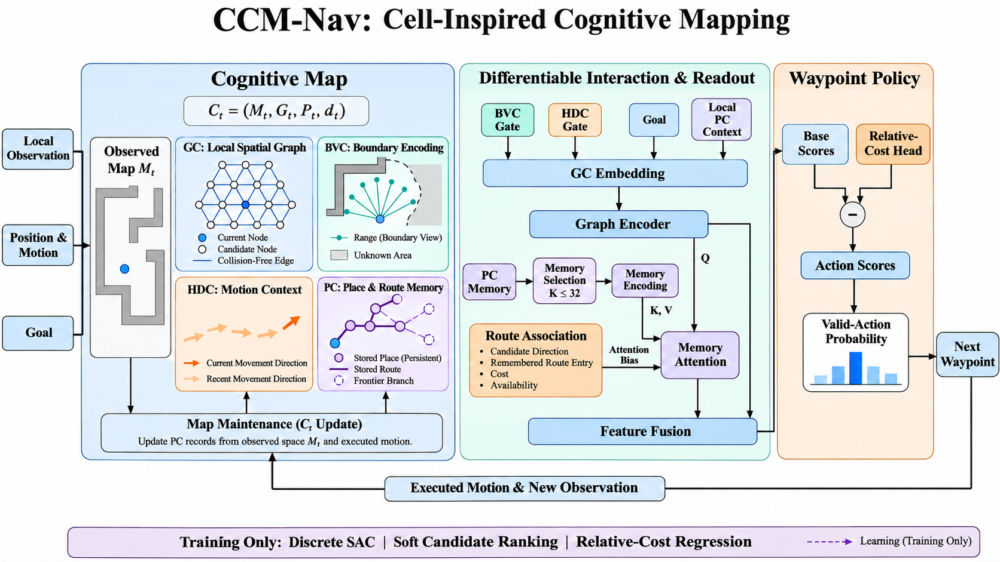
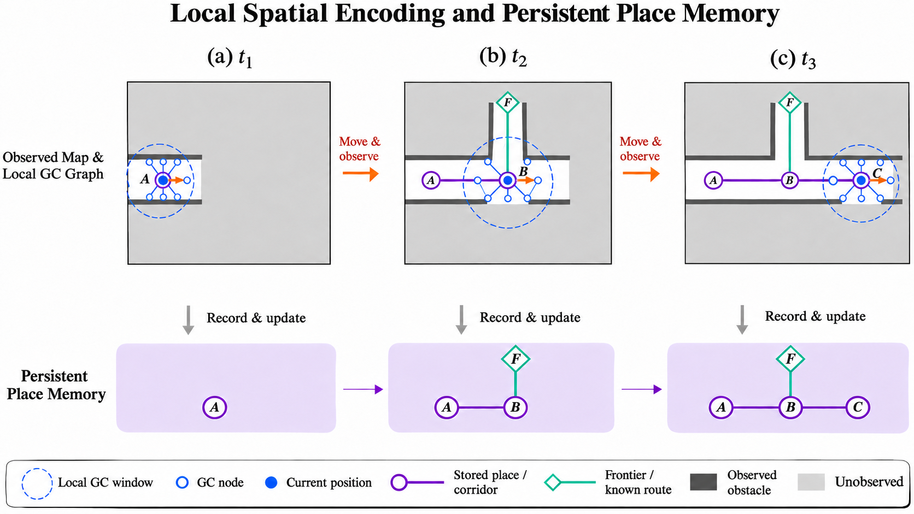
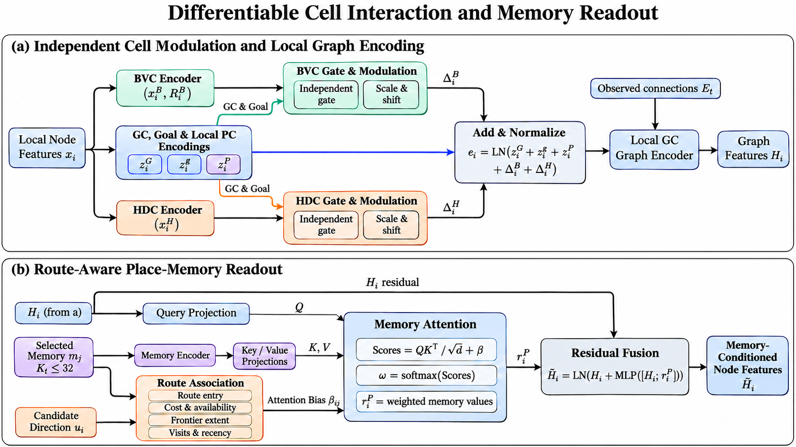
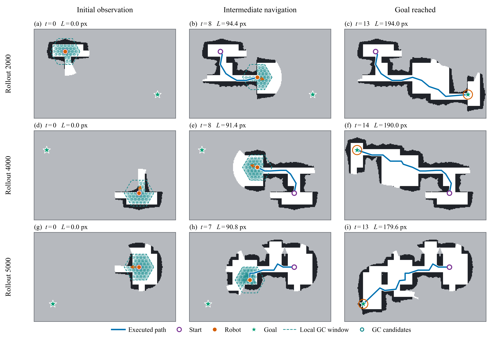
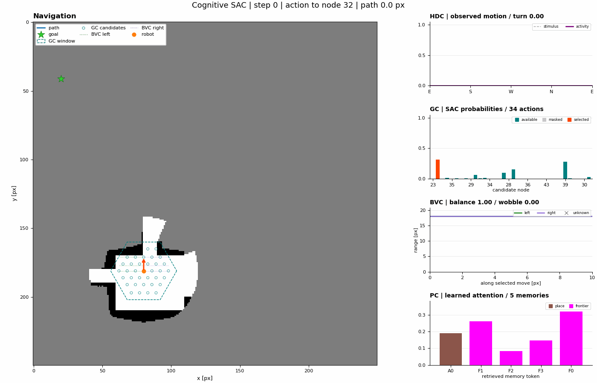
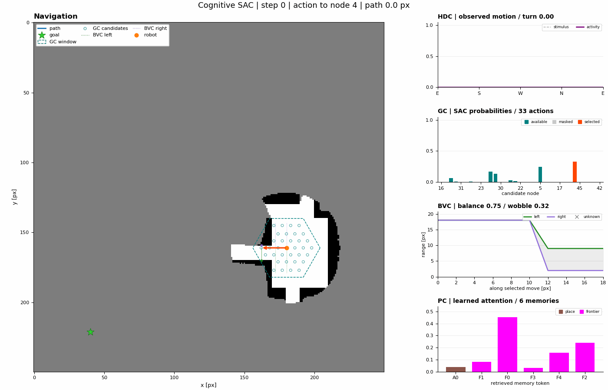
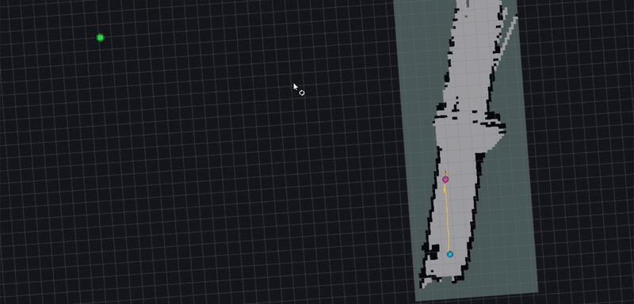
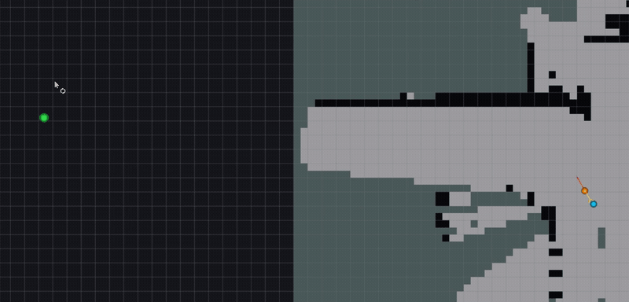

<h1 align="center">CCM-Nav</h1>

<strong>Cell-Inspired Cognitive Map Modeling for Navigation and Exploration</strong>

Turning partial observations and spatial experience into knowledge for action.

  <a href="#overview">Overview</a> ·
  <a href="#navigation-demos">Navigation Demos</a> ·
  <a href="#real-world-demos">Real-World Demos</a> ·
  <a href="#results">Results</a>

  

## Overview

**CCM-Nav is a cell-inspired cognitive map modeling method for goal-directed navigation and autonomous exploration in unknown environments.** It combines local spatial encoding with persistent place and route memory, and learns how spatial cues interact and how stored knowledge is retrieved for action evaluation.

The cognitive map evolves as the robot observes and moves. A fixed navigation policy uses this maintained spatial knowledge to select successive waypoints; downstream planning and control execute the selected targets.

- **Construct spatial knowledge online.** A local graph organizes observed traversable space, while persistent memory retains places and routes beyond the current local window.
- **Learn how spatial cues work together.** Boundary and motion information modulate local spatial representations through independent cell-interaction pathways.
- **Retrieve knowledge relevant to actions.** Route-aware memory attention relates candidate directions to stored route entry, length, and availability.
- **Support navigation and exploration.** Point-goal navigation and goal-free exploration share the cognitive-map design, with task-specific observations, objectives, and checkpoints.

### Cognitive Map Maintenance

  

As the local window advances, earlier places and traversed connections remain available in memory. Local observations and retained experience jointly inform later decisions.

<strong>Cell interaction and route-aware memory readout</strong>

  

Grid-cell geometry, boundary information, movement direction, and place history are encoded into local graph features. These features query selected memory records through route-aware attention. The fused representation supports waypoint scoring and relative travel-cost prediction.

## Navigation Demos

  

**Observed space expands, the local graph follows the robot, and the executed trajectory connects start to goal.** These illustrative sequences come from V2 training rollouts; benchmark results are reported separately below.

<strong>Animated training rollouts with cell and memory diagnostics</strong>

<table>
  <tr>
    <td align="center"></td>
    <td align="center"></td>
    <td align="center"></td>
  </tr>
  <tr>
    <td align="center">Episode 3000</td>
    <td align="center">Episode 5000</td>
    <td align="center">Episode 7000</td>
  </tr>
</table>

The animations show m6.3 training trajectories and their spatial diagnostics. Click an animation to inspect it at full resolution. Media provenance is recorded in [assets.json](github/assets.json).

## Real-World Demos

The same simulation-trained CCM-Nav navigation policy is deployed in previously unseen indoor and outdoor environments **without additional training or fine-tuning**. CCM-Nav maintains its cognitive map and selects successive waypoints online, while CMU-Exploration handles local planning and tracking.

<table>
  <tr>
    <th align="center">Indoor Navigation</th>
    <th align="center">Outdoor Navigation</th>
  </tr>
  <tr>
    <td align="center"></td>
    <td align="center"></td>
  </tr>
  <tr>
    <td align="center">Corridor junctions and a narrow passage</td>
    <td align="center">Building-side roadway</td>
  </tr>
</table>

## Results

### Goal-Directed Navigation

Reported travel-distance comparison on the same **100 unseen test maps** and start–goal pairs:

| Method | Mean travel distance ± standard deviation (pixels) ↓ |
| --- | ---: |
| BIT\* | 275.2 ± 130.4 |
| D\* Lite | 224.6 ± 85.9 |
| CA | 253.9 ± 112.4 |
| Inpaint+A\* | 231.1 ± 125.8 |
| CogniPlan | 222.1 ± 64.7 |
| **CCM-Nav** | **207.7 ± 63.9** |

CCM-Nav achieves a **100% navigation success rate**, with **6.48% shorter mean travel distance** than CogniPlan. The reported overall inference comparison gives a **2.4× speedup**.

Baseline travel-distance statistics follow the published [CogniPlan comparison](https://proceedings.mlr.press/v305/wang25d.html). 
